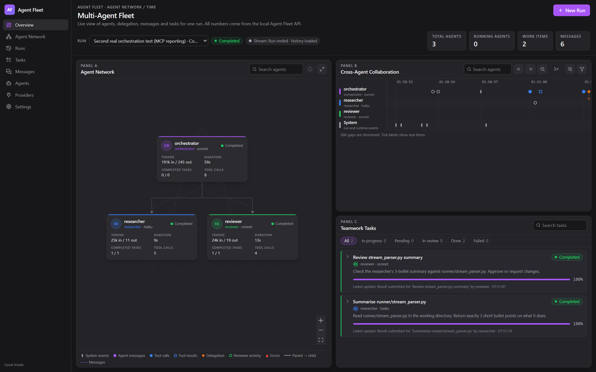
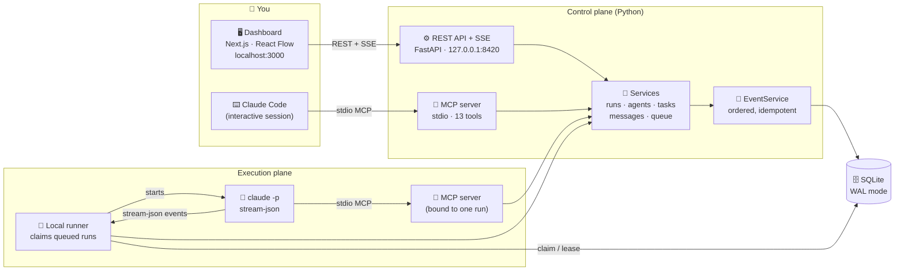
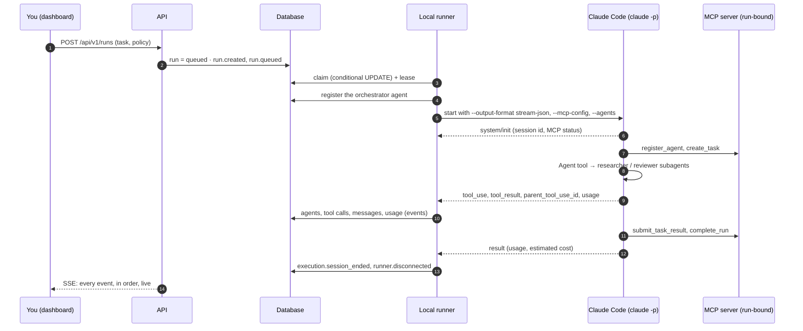
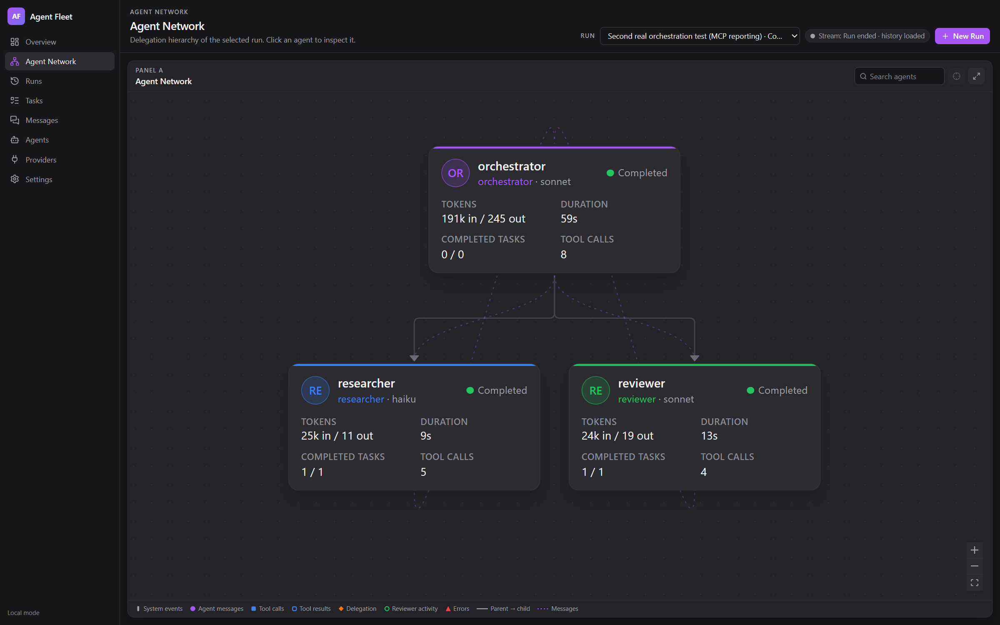
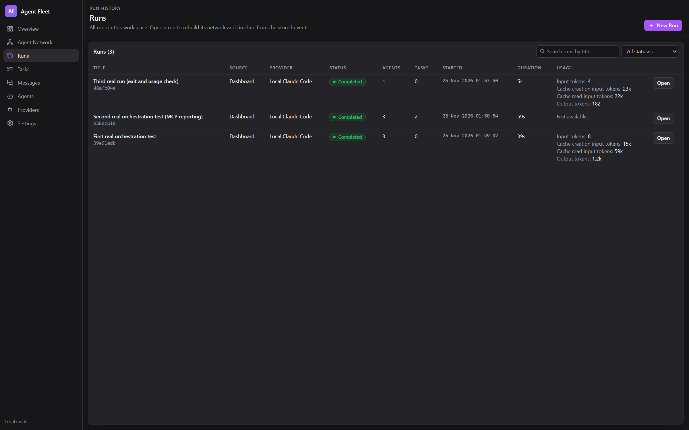

<div align="center">

# 🛰️ Agent Fleet

### Multi-agent orchestration and observability for Claude Code

**Give Claude Code a complex task. Watch a team of AI agents plan it, split it, delegate it and finish it — live.**

[](apps/backend/pyproject.toml)
[](apps/backend/agent_fleet/main.py)
[](apps/web)
[](apps/web/features/network)
[](docs/MCP_INTEGRATION.md)
[](docs/DATABASE.md)
[](#-quality-and-testing)
[](LICENSE)

<br/>



<sub><i>A real run: the Sonnet orchestrator delegates to a Haiku researcher and a Sonnet reviewer. Every number on the screen comes from recorded events.</i></sub>

</div>

---

## 📑 Contents

- [What is Agent Fleet?](#-what-is-agent-fleet)
- [Highlights](#-highlights)
- [How it works](#-how-it-works)
- [The agent team](#-the-agent-team)
- [Quick start](#-quick-start)
- [Using Agent Fleet](#-using-agent-fleet)
- [The dashboard](#-the-dashboard)
- [MCP tools for Claude Code](#-mcp-tools-for-claude-code)
- [REST API and live stream](#-rest-api-and-live-stream)
- [What gets recorded](#-what-gets-recorded)
- [Security model](#-security-model)
- [Configuration](#-configuration)
- [Project structure](#-project-structure)
- [Quality and testing](#-quality-and-testing)
- [Roadmap](#-roadmap)
- [Documentation](#-documentation)
- [License and acknowledgements](#-license-and-acknowledgements)

---

## 🧭 What is Agent Fleet?

Agent Fleet turns **Claude Code** into an observable team of AI agents.

A **Sonnet orchestrator** reads your task. It decides if the task needs a team. If it does, it splits the work
into tasks, delegates them to **specialized subagents** (Haiku for light work, Sonnet for complex work and review),
collects their results and publishes a final answer.

Agent Fleet **records every step** in a database and shows it **live** in a dashboard:

- which agents are running, and which model each one uses;
- who delegated which task to whom;
- which agents work in parallel;
- what the agents say to each other;
- which tools each agent calls;
- how the run progresses over time, with real token usage.

It runs on **your own computer** with **your installed, signed-in Claude Code**. With a Claude Pro or Max
subscription you need **no Anthropic API key**.

> **This is not a chatbot with personas.** It is an orchestration and observability system. The dashboard only
> shows what really happened. When a value is not reported, it shows "Not available" instead of a guess.

---

## ✨ Highlights

| | Feature | What it means |
|---|---|---|
| 🧠 | **Real multi-agent orchestration** | Claude Code's own `Agent` tool delegates to four project subagents. Agent Fleet reconstructs the hierarchy from the stream. |
| 🔀 | **Two ways to start work** | Start a run from the **dashboard**, or ask **Claude Code** to use the Agent Fleet MCP tools. Both write the same data. |
| 📡 | **Live updates** | Server-Sent Events with replay, resume (`Last-Event-ID`), reconnect and duplicate protection. |
| 🕸️ | **Agent network** | React Flow graph with a hierarchy layout, delegation edges, message edges and an inspector for each agent. |
| ⏱️ | **Collaboration timeline** | One lane per agent. Arrows link senders to receivers and delegators to assignees. |
| 📋 | **Task board** | Delegated tasks with status filters, real progress, results and errors. |
| 🔌 | **MCP server** | 13 tools over stdio. Claude Code registers agents, creates tasks, sends messages and submits results. |
| 🏃 | **Local runner** | Claims queued runs safely, starts `claude -p`, streams `stream-json`, handles timeouts, cancellation and crashes. |
| 🛡️ | **Safe by default** | Read-only runs, explicit confirmation for edits, no permission bypass, workspace path checks, secret redaction. |
| 🔍 | **Honest metrics** | No fabricated counts or progress. Costs are labelled as client-side estimates, never as charges. |
| 🧩 | **Extensible** | Provider interfaces for future bring-your-own-key APIs. Optional Graphify code-graph integration. |

---

## 🧱 How it works

Agent Fleet has five parts. They share **one service layer** and **one event log**.



**The key idea:** every state change goes through the same services and writes an ordered event in the same
transaction. The SSE stream reads those stored events, so the dashboard sees work from **any** process: the API,
the runner, or a Claude Code session on its own.

### Mode A — start a run from the dashboard



### Mode B — work inside Claude Code

Open `claude` in this repository. The project `.mcp.json` connects the **agent-fleet** MCP server. Ask Claude to
record its work. Claude calls `create_run`, `register_agent`, `create_task`, `send_agent_message`,
`submit_task_result` and `complete_run`. The run appears in the dashboard at once, because both modes use the
same database and event log.

---

## 🤖 The agent team

The subagents are official Claude Code agent files in [`.claude/agents/`](.claude/agents). Interactive sessions read
them from this folder. The runner passes the same files to each run with `claude --agents`.

| Agent | Model | Role | Edits files? |
|---|---|---|---|
| 🎯 **Orchestrator** | `sonnet` | Understands the request, plans, splits tasks, delegates, monitors, consolidates and publishes the final summary. Does simple work itself. | Only in *Workspace edit* runs |
| 🔎 **Researcher** | `haiku` | Gathers evidence and returns sourced findings with stated uncertainty. | No |
| 📊 **Analyst** | `haiku` | Extracts key data, patterns and contradictions. | No |
| 🛠️ **Executor** | `sonnet` | Builds deliverables and reports changed files and test results. | Only in *Workspace edit* runs |
| ✅ **Reviewer** | `sonnet` | Reviews results independently and returns a verdict and issues. | No |

Each subagent gets its run id, its agent id and its task id in the first lines of its prompt. It reports its start,
status changes and result through the MCP tools. Subagents do not start further subagents. A run allows at most
**4 active subagents** by default.

> These agents run inside **your own Claude Code session**. They share its subscription usage and limits. They are
> not separate, separately billed model instances.

---

## 🚀 Quick start

### Prerequisites

| Tool | Version | Check |
|---|---|---|
| Windows 10/11 (macOS and Linux also work) | — | — |
| [Node.js](https://nodejs.org) | 22 or newer | `node --version` |
| [pnpm](https://pnpm.io) | 11 or newer | `pnpm --version` |
| [Python](https://www.python.org) | 3.12 | `python --version` |
| [uv](https://docs.astral.sh/uv/) | recent | `uv --version` |
| [Claude Code](https://code.claude.com/docs/en/setup) | 2.1.281 or newer, signed in | `claude auth status` |

### 1. Clone and set up

```powershell
git clone https://github.com/mayankmalik263/agent-fleet.git
```

```powershell
cd agent-fleet
```

```powershell
powershell -ExecutionPolicy Bypass -File scripts\setup.ps1
```

The setup script checks your tools, creates `.env` from `.env.example`, installs the Python and Node packages,
creates the SQLite database, and shows your Claude Code sign-in status.

<details>
<summary><b>macOS / Linux / Git Bash</b></summary>

```bash
git clone https://github.com/mayankmalik263/agent-fleet.git
cd agent-fleet
./scripts/setup.sh
```

</details>

### 2. Start everything

```powershell
pnpm dev
```

This starts three processes together:

| Process | Address | Purpose |
|---|---|---|
| **API** | http://127.0.0.1:8420 (docs at `/docs`) | REST API, SSE stream, system status |
| **Runner** | — | Claims queued runs and starts Claude Code |
| **Dashboard** | http://localhost:3000 | The observability console |

Press <kbd>Ctrl</kbd>+<kbd>C</kbd> to stop all three. To debug one part, start it alone with `pnpm dev:api`,
`pnpm dev:runner` or `pnpm dev:web`.

### 3. Connect Claude Code (MCP)

1. Open a terminal in the repository.
2. Run `claude`.
3. Approve the **agent-fleet** server when Claude Code asks (project servers need your approval once).
4. Type `/mcp`. The list shows **agent-fleet** as connected with **13 tools**.

To use Agent Fleet from **other** projects too, register it for your user (change the path):

```powershell
claude mcp add agent-fleet --scope user -- uv run --quiet --directory C:/path/to/agent-fleet/apps/backend agent-fleet-mcp
```

---

## 💻 Using Agent Fleet

### Start a run from the dashboard

1. Open http://localhost:3000.
2. Click **New Run**.
3. Describe the task. Keep the provider **Local Claude Code** and the model **Sonnet**.
4. Keep the policy **Read-only**, or choose **Workspace edit** and confirm the warning.
5. Submit. The runner claims the run and starts Claude Code.
6. Watch the network, the timeline and the tasks update live.

A good first task:

> Explain in three short bullet points what `runner/stream_parser.py` in the working directory does.
> Delegate the reading to the researcher, then ask the reviewer to check the summary.

To let a run read one of your projects, add its parent folder to `AGENT_FLEET_ALLOWED_WORKSPACE_ROOTS` in `.env`,
then give the folder as the **workspace path**. Runs without a workspace get an empty folder in `data/workspaces/`.

### Start a run from Claude Code

Open `claude` in this repository and ask, for example:

> Use the Agent Fleet tools. Create a run for "Compare the README with the docs folder", delegate the reading to the
> researcher and the check to the reviewer, then complete the run with a summary.

The [project `CLAUDE.md`](CLAUDE.md) tells Claude how to report each step. A `SessionStart` hook gives Claude its
session id, so Claude Code's own subagent lifecycle events can attach to the run too.

### Permission policies

| Policy | Built-in tools | Mode | Shell commands | How to enable |
|---|---|---|---|---|
| **Read-only** (default) | Read, Grep, Glob, Agent | `dontAsk` (anything else is denied, never prompted) | none | default |
| **Workspace edit** | + Edit, Write, Bash | `acceptEdits` | explicit allowlist; destructive commands denied | dashboard warning + confirmation + workspace path |

Unattended runs use `--permission-prompts none`, so a run never waits for an approval nobody can give.
Agent Fleet never uses `--dangerously-skip-permissions` or `bypassPermissions`. Denied tool calls appear in the
timeline as `tool.failed` events.

---

## 📊 The dashboard

<table>
<tr>
<td width="50%"></td>
<td width="50%"></td>
</tr>
<tr>
<td align="center"><b>Agent Network</b> — delegation hierarchy, models, tokens, durations and tool calls</td>
<td align="center"><b>Run History</b> — every run, its source, status, size, duration and reported usage</td>
</tr>
</table>

| Part | What you see |
|---|---|
| **Header** | Total agents, running agents, work items and messages for the selected run, the run status and the stream status. |
| **Panel A — Agent Network** | A hierarchy graph. Each node shows initials, name, model, status, tokens (or "Not available"), a live duration, completed tasks and tool calls. Zoom, pan, fit, search and focus. Select a node to highlight its relations; click it to open the **Agent Inspector**. |
| **Panel B — Cross-Agent Collaboration** | A horizontal timeline with one lane per agent and a System lane. Markers by event category, arrows for messages and delegation, zoom, earliest/latest navigation and filters. |
| **Panel C — Teamwork Tasks** | Expandable task cards with filters (All, In progress, Pending, In review, Done, Failed) and search. |
| **Other pages** | Runs, Agent Network, Tasks, Messages, Agents, Providers (Claude Code, runner and Graphify status) and Settings. |

Below 1024 px wide, a **Network / Timeline / Tasks** switcher replaces the two columns. See
[docs/DESIGN.md](docs/DESIGN.md) for the full design system.

---

## 🔌 MCP tools for Claude Code

| Tool | Purpose |
|---|---|
| `create_run` | Start a run (`claude_code` source reports itself; `dashboard`/`api` queue it for the runner). |
| `register_agent` | Add an agent with name, role, model alias and optional parent. |
| `update_agent_status` | Move an agent through idle, queued, running, waiting, reviewing, completed, failed, cancelled. |
| `create_task` | Record a delegated task for an agent. |
| `update_task_status` | Change task status and, only when measured, progress. |
| `submit_task_result` | Store the public result (summary plus a JSON payload) and complete the task. |
| `send_agent_message` | Record a message between agents. |
| `append_run_event` | Record an observation (tool use, progress, notice). State changes have dedicated tools. |
| `get_run_snapshot` | Read the run, agents, hierarchy, tasks, recent messages and counts. |
| `get_agent_details` | Read one agent with its parent, children, tasks, messages and tool activity. |
| `complete_run` / `fail_run` | Finish the run with a final summary, or fail it with a reason. |
| `query_code_graph` | Optional: ask a local Graphify code graph (read-only). |

The server writes **only JSON-RPC** to stdout; all logs go to stderr. A server that the runner starts for a run can
touch **only that run** and cannot create new runs, so runs can never start runs in a loop.
Details: [docs/MCP_INTEGRATION.md](docs/MCP_INTEGRATION.md).

---

## 🌐 REST API and live stream

All endpoints live under `/api/v1` (interactive docs at http://127.0.0.1:8420/docs).

| Area | Endpoints |
|---|---|
| Health and system | `GET /health` · `GET /system/status` · `GET /system/providers` · `GET /runner/status` · `GET /overview` |
| Runs | `POST /runs` · `GET /runs` · `GET /runs/{id}` · `POST /runs/{id}/cancel` · `GET /runs/{id}/snapshot` |
| Events | `GET /runs/{id}/events` · `GET /runs/{id}/events/stream` (SSE) |
| Agents | `GET /runs/{id}/agents` · `GET /agents/{id}` · `PATCH /agents/{id}` |
| Tasks | `GET /runs/{id}/tasks` · `GET /tasks/{id}` · `PATCH /tasks/{id}` |
| Messages and approvals | `GET /runs/{id}/messages` · `GET /runs/{id}/approvals` |

Lists support pagination, filters and sorting. Every error uses one envelope:
`{"error": {"code", "message", "details"}}`.

**The SSE stream** sends each event as `id: <sequence number>` plus `data: <event JSON>`. A reconnecting client
resumes with `Last-Event-ID` or `?after=` and gets no gaps and no duplicates. A final `event: end` arrives after the
runner's last events. Full contract: [docs/TECHNICAL_SPECIFICATION.md](docs/TECHNICAL_SPECIFICATION.md).

---

## 📜 What gets recorded

Every event has a UUID, the run id, a **gap-free per-run sequence number**, a UTC timestamp, the related agent and
task, a source (`api`, `mcp`, `runner`, `hook`, `system`) and a **sanitized** payload.

| Group | Event types |
|---|---|
| Run | `run.created` · `run.queued` · `run.started` · `run.status_changed` · `run.completed` · `run.failed` · `run.cancelled` |
| Agent | `agent.created` · `agent.started` · `agent.status_changed` · `agent.waiting` · `agent.completed` · `agent.failed` |
| Task | `task.created` · `task.started` · `task.progress` · `task.blocked` · `task.review_requested` · `task.completed` · `task.failed` |
| Communication | `message.sent` · `message.received` |
| Tools | `tool.started` · `tool.completed` · `tool.failed` (incl. permission denials) |
| Execution | `runner.connected` · `runner.disconnected` · `execution.session_started` · `execution.session_ended` · `execution.usage_reported` · `execution.notice` |
| Approval | `approval.requested` · `approval.approved` · `approval.rejected` |

The database has ten tables: users, workspaces, runner devices, provider connections, runs, agents, tasks, agent
messages, run events and approval requests, with Alembic migrations. See [docs/DATABASE.md](docs/DATABASE.md).

**Never stored:** thinking blocks or hidden reasoning, Claude credentials, API keys or tokens (secrets are redacted
from payloads, messages and logs).

---

## 🔒 Security model

Agent Fleet is a **local, single-user** tool. Its local mode is **not** a multi-tenant SaaS security model.

- **Local only.** The API binds to `127.0.0.1`, allows only the local dashboard origin and rejects non-local `Host`
  headers (DNS-rebinding protection).
- **No credential access.** It reads Claude Code status only through `claude --version`, `claude --help` and
  `claude auth status --json`, and keeps only `loggedIn`, `authMethod`, `apiProvider` and `subscriptionType`.
- **Subscription, not API billing.** The runner removes `ANTHROPIC_API_KEY` from Claude Code's environment.
- **Safe processes.** Argument arrays only (never `shell=True`), timeouts, process-tree cleanup, and the npm `.cmd`
  shim is bypassed for the native `claude.exe`.
- **Confined runs.** Workspace paths must sit inside allowed roots (symlinks and `..` cannot escape). A run's MCP
  server is bound to that run and starts in Python isolated mode, so workspace files cannot inject code.
- **Untrusted repositories.** Runs ignore the workspace's own `.mcp.json` and project settings
  (`--strict-mcp-config`, `--setting-sources user`).

The local Claude Code connector is a **local development / self-hosted integration**. It does not bundle, modify or
redistribute Claude Code, and it refuses to run in commercial mode. Full model and production requirements:
[docs/SECURITY.md](docs/SECURITY.md).

---

## 🔧 Configuration

All settings are environment variables with the `AGENT_FLEET_` prefix, read from `.env`. The most useful ones:

| Variable | Default | Purpose |
|---|---|---|
| `AGENT_FLEET_DATABASE_URL` | `sqlite:///…/data/agent_fleet.sqlite3` | Database (PostgreSQL-compatible schema) |
| `AGENT_FLEET_API_PORT` | `8420` | API port |
| `AGENT_FLEET_ALLOWED_WORKSPACE_ROOTS` | *(empty)* | Folders that runs may use (`;`-separated) |
| `AGENT_FLEET_MAX_CONCURRENT_AGENTS` | `4` | Default subagent limit per run |
| `AGENT_FLEET_RUN_TIMEOUT_SECONDS` | `1800` | Hard limit per run |
| `AGENT_FLEET_RUNNER_MAX_CONCURRENT_RUNS` | `1` | Runs one runner executes at the same time |
| `AGENT_FLEET_EDIT_BASH_ALLOWLIST` | `git status,git diff *,git log *` | Shell commands allowed in *Workspace edit* runs |
| `AGENT_FLEET_ALLOW_WEB_TOOLS` | `false` | Give agents WebSearch and WebFetch |
| `AGENT_FLEET_CLAUDE_PATH` | *(auto-detect)* | Path to the `claude` executable |

The full list with comments is in [`.env.example`](.env.example) and [docs/DEVELOPMENT.md](docs/DEVELOPMENT.md).

---

## 📁 Project structure

```text
agent-fleet/
├── apps/
│   ├── backend/                 Python control plane (uv project)
│   │   ├── agent_fleet/
│   │   │   ├── api/             REST routes, SSE stream, errors, pagination
│   │   │   ├── core/            settings, enums, state machine, redaction
│   │   │   ├── database/        engine (WAL, IMMEDIATE/DEFERRED), migrations runner
│   │   │   ├── models/          SQLAlchemy ORM (10 tables)
│   │   │   ├── repositories/    workspace-scoped lookups
│   │   │   ├── schemas/         Pydantic API schemas
│   │   │   ├── services/        runs, agents, tasks, messages, events, queue, hooks
│   │   │   ├── mcp/             stdio MCP server (13 tools)
│   │   │   ├── runner/          worker, stream parser, event mapper, prompt, policy
│   │   │   ├── providers/       provider interfaces, Claude Code detection + runtime
│   │   │   └── integrations/    Claude Code hook relay, Graphify connector
│   │   ├── migrations/          Alembic
│   │   └── tests/               pytest + fake Claude Code CLI
│   └── web/                     Next.js dashboard
│       ├── app/                 routes (8 pages)
│       ├── features/            network, timeline, tasks, inspector, runs, providers…
│       ├── lib/                 typed API client, SSE client, layout, timeline geometry
│       └── tests/               Vitest + Testing Library
├── .claude/
│   ├── agents/                  researcher, analyst, executor, reviewer
│   └── settings.json            hooks + MCP tool permissions
├── docs/                        9 guides (see below)
├── scripts/                     setup, dev and test scripts (PowerShell + bash)
├── .mcp.json                    project MCP server for Claude Code
└── CLAUDE.md                    orchestration instructions for Claude Code
```

---

## 🧪 Quality and testing

Run every check with one command:

```powershell
powershell -ExecutionPolicy Bypass -File scripts\test.ps1
```

| Check | Tool | Result |
|---|---|---|
| Backend lint | ruff | ✅ clean |
| Backend types | mypy | ✅ clean (67 files) |
| Backend tests | pytest | ✅ 75 passed, 1 opt-in skipped |
| Frontend lint and types | ESLint, TypeScript | ✅ clean |
| Frontend tests | Vitest + Testing Library | ✅ 49 passed |
| Production build | `next build` | ✅ succeeds |

**No test calls a real model.** A fake Claude Code executable writes realistic `stream-json` for end-to-end runs,
malformed output, crashes, hangs, authentication errors and more. In the end-to-end test it talks to the **real MCP
server** over stdio, so the full path — dashboard request → queue → runner → Claude Code → MCP → database → API — is
tested.

**Verified with real Claude Code.** Three real runs on Windows with a Claude Pro login completed end to end. Real
runs found two bugs that mocks could not (a workspace folder that shadowed the MCP library, and a process stopped
before it reported usage). An independent code review then found 13 more issues. All 15 are fixed and each has a
regression test.

An optional real smoke test uses your subscription and runs only when you ask for it:

```powershell
$env:AGENT_FLEET_REAL_CLAUDE_SMOKE="1"; uv run --directory apps/backend pytest -m real_claude
```

---

## 📍 Roadmap

- [x] Local control plane, event log, REST API and SSE
- [x] MCP server for Claude Code (13 tools)
- [x] Local runner for the official Claude Code CLI
- [x] Observability dashboard (network, timeline, tasks, inspector, history)
- [x] Hooks for Claude Code–started runs, optional Graphify integration
- [ ] Bring-your-own-key Anthropic API provider (interfaces are ready; see the provider abstraction)
- [ ] Protected remote MCP (Streamable HTTP with authentication)
- [ ] Interactive approvals during a run (`awaiting_approval`)
- [ ] PostgreSQL deployment profile and a scalable job queue
- [ ] Browser end-to-end tests (Playwright)
- [ ] Multi-user authentication and workspace authorization

---

## 📚 Documentation

| Guide | Contents |
|---|---|
| [Architecture](docs/ARCHITECTURE.md) | Control, execution and observability planes; both modes; event pipeline |
| [Design](docs/DESIGN.md) | Dashboard layout, colour system, agent nodes, timeline, task cards |
| [Technical specification](docs/TECHNICAL_SPECIFICATION.md) | API, SSE, MCP tools, state machines, event model, lifecycle |
| [Database](docs/DATABASE.md) | Tables, keys, indexes, migrations, SQLite concurrency |
| [MCP integration](docs/MCP_INTEGRATION.md) | Connecting Claude Code, hooks, troubleshooting |
| [Execution engine](docs/EXECUTION_ENGINE.md) | Runner, CLI arguments, stream mapping, failures, permissions |
| [Graphify integration](docs/GRAPHIFY_INTEGRATION.md) | Optional code knowledge graph |
| [Security](docs/SECURITY.md) | Threat model, controls, production requirements |
| [Development](docs/DEVELOPMENT.md) | Setup, commands, environment, extending the system |
| [Agents](AGENTS.md) | The agent team and its rules |

<details>
<summary><b>🩺 Troubleshooting</b></summary>

| Symptom | Fix |
|---|---|
| Providers page: "Claude Code was not found" | Install Claude Code, or set `AGENT_FLEET_CLAUDE_PATH` in `.env` |
| "Claude Code is not signed in" | Run `claude auth login` |
| A run stays **queued** | Start the runner (`pnpm dev:runner`) and check the Providers page |
| "workspace_path is outside the allowed workspace roots" | Add the parent folder to `AGENT_FLEET_ALLOWED_WORKSPACE_ROOTS` |
| "usage or rate limit reached" | Wait until your Claude usage limit resets |
| `/mcp` shows agent-fleet as failed | Run `uv sync --directory apps/backend`, then restart Claude Code |
| `pnpm setup` does something else | pnpm has a built-in `setup` command; use `scripts\setup.ps1` |
| A Python process stays alive after you close a terminal | `taskkill /IM agent-fleet-runner.exe /T /F` (or `agent-fleet-api.exe`) |

</details>

---

## 📄 License and acknowledgements

Agent Fleet is released under the [MIT License](LICENSE).

Built with [Claude Code](https://code.claude.com), the [Model Context Protocol](https://modelcontextprotocol.io)
Python SDK, [FastAPI](https://fastapi.tiangolo.com), [SQLAlchemy](https://www.sqlalchemy.org),
[Next.js](https://nextjs.org), [React Flow](https://reactflow.dev), [TanStack Query](https://tanstack.com/query),
[Tailwind CSS](https://tailwindcss.com) and [Lucide](https://lucide.dev). Optional code intelligence by
[Graphify](https://github.com/Graphify-Labs/graphify).

> Agent Fleet is an independent project. It is not affiliated with or endorsed by Anthropic. It uses your own Claude
> Code installation and login and follows Claude Code's documented interfaces.

<div align="center">
<br/>
<sub>Made by <a href="https://github.com/mayankmalik263">@mayankmalik263</a> · If this project helps you, consider giving it a ⭐</sub>
</div>
