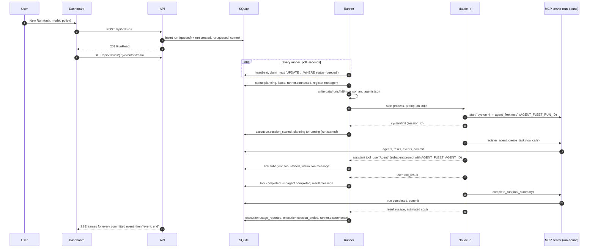
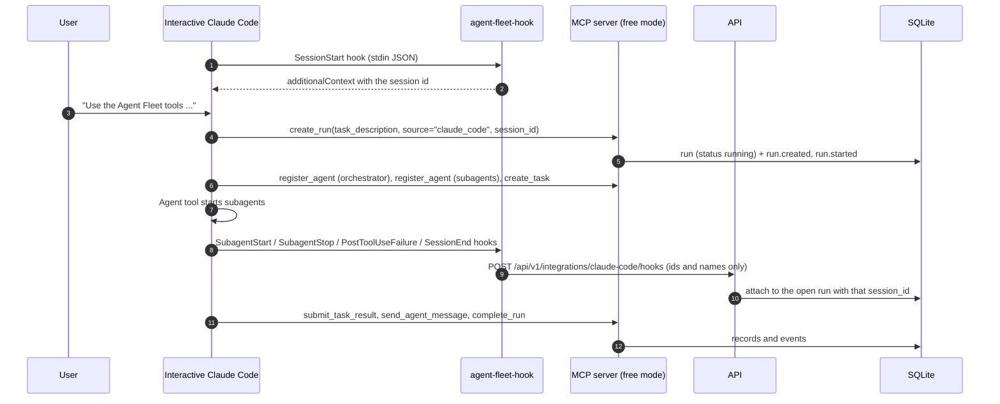

# Architecture

This document describes how Agent Fleet is built and how its parts talk to each other.
It describes the code in this repository. It does not describe planned features as if they exist.

Related documents: [Technical specification](TECHNICAL_SPECIFICATION.md), [Database](DATABASE.md),
[MCP integration](MCP_INTEGRATION.md), [Execution engine](EXECUTION_ENGINE.md), [Security](SECURITY.md).

## 1. Summary

Agent Fleet records multi-agent work and shows it live. A Claude Code orchestrator delegates work to
subagents. Agent Fleet stores each run, agent, task, message and event in one database. A dashboard reads
these records through a REST API and a Server-Sent Events (SSE) stream.

Two paths write the same data model:

- **Mode A (dashboard):** a person starts a run in the dashboard. The local runner starts `claude -p`.
- **Mode B (Claude Code):** a person works in an interactive Claude Code session. Claude calls the
  `agent-fleet` MCP tools to record its own work.

Agent Fleet does not call a model itself. Claude Code does all model work. Agent Fleet supplies the
records, the rules for the records, and the views.

## 2. The three planes

Agent Fleet has three logical planes. Each plane has a clear job.

| Plane | Job | Main code |
|---|---|---|
| Control plane | Owns the data model and the rules: validation, state machines, workspace scope, the event log | `apps/backend/agent_fleet/services/`, `core/`, `models/`, `repositories/scoped.py`, `api/`, `mcp/server.py` |
| Execution plane | Runs Claude Code for queued runs and turns its output into records | `apps/backend/agent_fleet/runner/`, `providers/claude_code.py`, `providers/claude_cli.py` |
| Observability plane | Makes the records visible: event history, live stream, snapshots, dashboard | `services/events.py`, `api/stream.py`, `api/routes_runs.py`, `apps/web/` |

### 2.1 Control plane

The control plane is a set of Python services. Three adapters call the same services:

- the REST API (`api/routes_*.py`),
- the MCP server (`mcp/server.py`),
- the runner (`runner/worker.py`, `runner/event_mapper.py`).

The adapters contain no business rules. For example, `mcp/server.py` says: "The tools are thin adapters
over the same services the REST API uses".

| Service | File | Responsibility |
|---|---|---|
| `RunService` | `services/runs.py` | Create runs, change run status, complete, fail, cancel, build snapshots |
| `AgentService` | `services/agents.py` | Register agents, change agent status, enforce the subagent limit, agent details |
| `TaskService` | `services/tasks.py` | Create tasks, change task status and progress, accept results |
| `MessageService` | `services/messages.py` | Record agent messages and free-form events |
| `EventService` | `services/events.py` | The only writer of `run_events` |
| `RunQueue` | `services/queue.py` | Runner registry, claims, leases, recovery |
| `record_hook_event` | `services/hooks.py` | Attach Claude Code hook events to a Mode B run |
| `resolve_workspace_path` | `services/workspace_paths.py` | Check that a workspace folder is inside an allowed root |

Every lookup goes through `repositories/scoped.py`. A record from another workspace is reported as
"not found".

### 2.2 Execution plane

The execution plane is the local runner process (`agent-fleet-runner`). It:

1. polls the database for queued runs,
2. claims one run with a conditional `UPDATE`,
3. writes a run-specific MCP configuration and a subagent definition file,
4. starts `claude -p --output-format stream-json` with a permission policy,
5. parses the stream and records agents, tools, messages and usage,
6. renews a lease while Claude Code runs,
7. records the final state when Claude Code exits.

The details are in [EXECUTION_ENGINE.md](EXECUTION_ENGINE.md).

### 2.3 Observability plane

The `run_events` table is the source of truth for timelines, replay and the live stream
(`models/event.py`). Each event has a per-run sequence number with no gaps. The SSE endpoint polls this
table. Thus an event that any process writes reaches the browser.

## 3. Components

```
 ┌──────────────────────────────┐        REST (JSON) + SSE        ┌────────────────────────────────────┐
 │ Dashboard (Next.js)          │ ───────────────────────────────►│ API (FastAPI)  127.0.0.1:8420       │
 │ apps/web, localhost:3000     │                                 │ agent_fleet.main:run                │
 └──────────────────────────────┘                                 └───────────────┬────────────────────┘
                                                                                  │ services
 ┌──────────────────────────────┐   stdio MCP (JSON-RPC)   ┌─────────────────────┐│
 │ Interactive Claude Code      │ ────────────────────────►│ agent-fleet MCP      ││
 │ (Mode B, project .mcp.json)  │                          │ server (free mode)   ├┤
 │  hooks ──► agent-fleet-hook ─┼── HTTP POST /api/v1/integrations/claude-code/hooks ──►(API)
 └──────────────────────────────┘                          └─────────────────────┘│
                                                                                  ▼
 ┌──────────────────────────────┐                                    ┌────────────────────────────┐
 │ Local runner                 │ ── claims, leases, events ────────►│ SQLite (WAL)               │
 │ agent-fleet-runner           │                                    │ data/agent_fleet.sqlite3   │
 │   └─ claude -p (Mode A) ─────┼─ stdio MCP ─► agent-fleet MCP      └────────────────────────────┘
 │        stream-json ◄─────────┤              server (run-bound) ───────────────▲
 └──────────────────────────────┘
```

### 3.1 Frontend

The frontend is a Next.js dashboard in `apps/web` (package `@agent-fleet/web`). It reads the REST API and
the SSE stream. It reads the API base URL from `NEXT_PUBLIC_AGENT_FLEET_API_URL`
(default `http://127.0.0.1:8420`, `apps/web/lib/config.ts`).

| Part | Technology |
|---|---|
| Framework | Next.js 16.4 (App Router), React 19.3, TypeScript |
| Agent network | `@xyflow/react` 13 (React Flow) |
| Data fetching | TanStack Query 5 |
| Styles and icons | Tailwind CSS 4, `lucide-react` |
| Tests | Vitest 5 |

How the dashboard keeps a run up to date:

1. It fetches the run snapshot (`GET /api/v1/runs/{id}/snapshot`). The snapshot is the source of truth.
2. The SSE client (`apps/web/lib/sse.ts`) opens the stream with `after=0`, so it replays the full event log.
3. The client drops events whose `sequence_number` it has already seen.
4. On a connection error, the client closes the stream and reconnects with exponential backoff. It resumes
   with `?after=<last sequence number>`.
5. New events update the snapshot in memory as an incremental overlay (`apps/web/lib/liveState.ts`).
6. The dashboard fetches the snapshot again after a short delay (debounced), so the overlay never drifts far
   from the stored state.
7. The client stops for good when it receives `event: end`.

This document does not describe the dashboard components.

### 3.2 Backend

The backend is one Python package, `agent_fleet`, in `apps/backend`. `pyproject.toml` defines five
console entry points:

| Entry point | Target | Purpose |
|---|---|---|
| `agent-fleet-api` | `agent_fleet.main:run` | REST API and SSE (uvicorn) |
| `agent-fleet-runner` | `agent_fleet.runner.main:main` | Local runner |
| `agent-fleet-mcp` | `agent_fleet.mcp.server:main` | MCP server over stdio |
| `agent-fleet-db` | `agent_fleet.database.migrate:main` | Apply migrations (`upgrade`) or show the revision (`current`) |
| `agent-fleet-hook` | `agent_fleet.integrations.claude_hooks:main` | Claude Code hook relay |

The API, the runner and the MCP server each call `upgrade()` at start (`database/migrate.py`). This is a
no-op when the schema is at head.

### 3.3 Local runtime

Agent Fleet uses the Claude Code CLI that the user installed and signed in. It does not bundle Claude Code.
Detection uses only `claude --version`, `claude --help` and `claude auth status --json`
(`providers/claude_cli.py`). From the auth status it keeps only `loggedIn`, `authMethod`, `apiProvider`
and `subscriptionType`.

On Windows, npm installs a `claude.cmd` shim. A `.cmd` file sends arguments through `cmd.exe`. This is not
safe for free prompt text. Thus `find_executable()` uses the native binary
`node_modules/@anthropic-ai/claude-code/bin/claude.exe` next to the shim.

### 3.4 Storage

SQLite in WAL mode is the only implemented database. The schema is written to be portable to PostgreSQL,
and `database/engine.py` accepts a non-SQLite URL. PostgreSQL is **not** tested or used in this
repository. See [DATABASE.md](DATABASE.md).

## 4. MCP communication

MCP is an integration protocol between Claude Code and Agent Fleet. It does not do inference. Claude Code
calls Agent Fleet tools; Agent Fleet stores records.

Two kinds of MCP server process exist. Both run the same code (`mcp/server.py`) over stdio.

| Kind | Started by | Command | Scope |
|---|---|---|---|
| Free mode | Interactive Claude Code, from the project `.mcp.json` | `uv run --quiet --directory apps/backend agent-fleet-mcp` | All runs of the workspace; may create runs |
| Run-bound mode | `claude -p` that the runner starts, from `data/runs/<run_id>/mcp.json` | `<venv python> -I -m agent_fleet.mcp` with `AGENT_FLEET_RUN_ID` | Only that run; may not create runs |

stdout carries only JSON-RPC messages. All logs go to stderr (`core/logging.py`).
Only the stdio transport is enabled. See [MCP_INTEGRATION.md](MCP_INTEGRATION.md).

## 5. Event pipeline

Every state change and every observation becomes one row in `run_events`. The order of operations is
fixed (`services/events.py`):

```
 caller (API / MCP / runner / hook)
   │ 1. change state (run, agent, task, message) in a transaction
   │ 2. EventService.emit()
   │      ├─ if idempotency_key exists for this run: return the old event (no new row)
   │      ├─ UPDATE runs SET event_seq = event_seq + 1 ... RETURNING event_seq   (atomic)
   │      ├─ redact message (max 2,000 chars) and sanitize payload
   │      └─ INSERT run_events (sequence_number = new event_seq)
   │ 3. COMMIT  ── the event is now durable
   ▼
 SSE endpoint (api/stream.py), in the API process
   loop: SELECT run_events WHERE sequence_number > cursor ORDER BY sequence_number LIMIT 500
         send "id: <seq>\ndata: <EventRead JSON>\n\n" for each row; cursor = last seq
         if the stream is finished (see below): send "event: end" and close
         else sleep 0.5 s (": keep-alive" comment after 15 s without events)
```

The stream is finished only when all of these are true (`api/stream._stream_finished`):

1. The run status is terminal.
2. The cursor has reached `runs.event_seq`.
3. No more runner events can come. This is true when the run has no `runner_device_id` (Mode B, or a run
   cancelled before a claim), or a `runner.disconnected` event exists, or `completed_at` is more than
   `END_GRACE_SECONDS` (90 s) in the past.

Rule 3 exists because the runner writes its last events (`execution.usage_reported`,
`execution.session_ended`, `runner.disconnected`) after the run status became terminal.

Properties of this design:

- **Cross-process.** The runner and the MCP server are separate processes. They do not push to the API.
  The API reads what they committed.
- **No lost or duplicate events on reconnect.** The browser sends `Last-Event-ID`. The stream resumes after
  that sequence number.
- **State and log agree.** Lifecycle events come only from the service that changes the state. Agents may
  append only the observational types in `FREEFORM_EVENT_TYPES` (`core/enums.py`).
- **Retries are safe.** An idempotency key makes a repeated write a no-op. The stream mapper uses keys such
  as `stream:tool:<tool_use_id>:start`.

## 6. Mode A: run started from the dashboard



## 7. Mode B: run started inside Claude Code



The runner never claims a Mode B run. `RunQueue.claim_next()` skips runs with `source = claude_code`
(`services/queue.py`). A Mode B run starts with status `running`.

## 8. Process model on Windows

`pnpm dev` (root `package.json`) runs `concurrently -k -n api,runner,web`. The `-k` option stops the other
processes when one stops.

```
pnpm dev
 └─ concurrently -k
     ├─ uv run --directory apps/backend agent-fleet-api      → agent-fleet-api.exe (uvicorn, 127.0.0.1:8420)
     ├─ uv run --directory apps/backend agent-fleet-runner   → agent-fleet-runner.exe (asyncio loop)
     │     └─ claude.exe -p ... (one per active run, CREATE_NEW_PROCESS_GROUP)
     │           ├─ python.exe -I -m agent_fleet.mcp          (run-bound MCP server)
     │           └─ tool processes started by Claude Code
     └─ pnpm --filter @agent-fleet/web dev                    → next dev --port 3000
```

Notes:

- `runner/process.py` starts Claude Code with `CREATE_NEW_PROCESS_GROUP` on Windows and
  `start_new_session=True` on other systems.
- To stop a run, `kill_tree()` runs `taskkill /PID <pid> /T /F` on Windows. On other systems it sends
  `SIGTERM` to the process group, then `SIGKILL` after 5 seconds.
- The runtime also kills the Claude Code process tree when the runner is interrupted (shutdown, task
  cancellation or an unexpected error). It catches `BaseException` and runs `kill_tree()` inside
  `asyncio.shield()`, so the kill completes even while the task is being cancelled
  (`providers/claude_code.ClaudeCodeLocalRuntime.execute`). Claude Code never keeps running without a runner.
- If you close only a parent shell, `agent-fleet-runner.exe` or `agent-fleet-api.exe` can stay alive.
  Stop them with `taskkill /IM agent-fleet-runner.exe /T /F` (see [DEVELOPMENT.md](DEVELOPMENT.md)).

## 9. Why the runner is a separate process

The runner does not run inside the API process. The reasons are:

1. **Long work.** A Claude Code session can last up to `AGENT_FLEET_RUN_TIMEOUT_SECONDS` (default 1,800 s).
   An HTTP request must not wait for it.
2. **Crash isolation.** A runner crash does not stop the API or the dashboard. When the lease has expired
   and the runner has sent no heartbeat for one lease period, `RunQueue.recover()` repairs the run.
3. **One queue for many runners.** Claims are conditional `UPDATE` statements. Two runners can never take
   the same run (test: `tests/test_runner.py::test_two_runners_never_claim_the_same_run`).
4. **Restart safety.** The API can restart during a run. The runner keeps writing events. The stream reads
   them when the browser reconnects.
5. **Clear privileges.** Only the runner starts Claude Code processes. The API only reads and writes records.

## 10. Provider abstraction

The orchestration core depends on interfaces, not on Claude Code (`providers/base.py`):

| Interface | Purpose | Implementation today |
|---|---|---|
| `ModelProvider` | A source of model execution | `AnthropicApiProvider` (design stub only) |
| `ProviderHealthCheck` | Can the provider run work now? | `registry.claude_code_health()`, `registry.anthropic_api_health()` |
| `ExecutionRuntime` | Runs one whole orchestration session and streams messages | `ClaudeCodeLocalRuntime` (`providers/claude_code.py`) |
| `AgentExecutor` | Runs one agent task (for API-style providers) | None |

Status of each provider:

- **Local Claude Code (`claude_code_local`)** is implemented.
- **Anthropic API (`anthropic_api`)** is a design only. Its health is always `unsupported_in_local_mode`.
  `AnthropicApiProvider.runtime()` raises `RuntimeUnavailableError`. A run request with
  `execution_provider = anthropic_api` fails with HTTP 503. Agent Fleet never falls back to another
  provider without telling you.

See [TECHNICAL_SPECIFICATION.md#provider-abstraction](TECHNICAL_SPECIFICATION.md#provider-abstraction).

## 11. What is not implemented

- Authentication and authorization. Local mode trusts every request to `127.0.0.1`.
- Remote MCP transport (HTTP). `AGENT_FLEET_MCP_TRANSPORT` other than `stdio` makes the server exit.
- PostgreSQL in production. The schema is portable, but only SQLite is used and tested.
- The Anthropic API provider.
- Approval workflows during a run. The `awaiting_approval` run status and the `approval.requested` and
  `approval.rejected` event types exist, but no code sets or emits them.
- Data retention and deletion. No code deletes runs or events.
