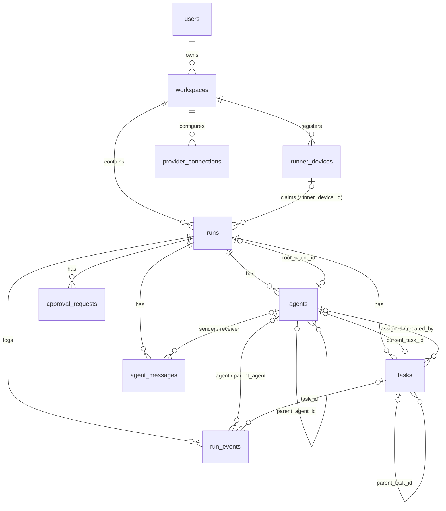

# Database

This document describes the Agent Fleet database: tables, columns, constraints, indexes, transactions and
migrations. It describes the code in `apps/backend/agent_fleet/models/` and the migration
`apps/backend/migrations/versions/0001_initial_schema.py`.

## 1. Overview

| Item | Value |
|---|---|
| Engine | SQLite 3 in WAL mode (the only engine that is implemented and tested) |
| Default file | `data/agent_fleet.sqlite3` in the repository root |
| ORM | SQLAlchemy 2 (`models/`) |
| Migrations | Alembic (`apps/backend/migrations/`), one revision: `0001` |
| Configuration | `AGENT_FLEET_DATABASE_URL` (`core/config.py`) |
| Writers | API process, runner process, every MCP server process |

Three kinds of process write the same file at the same time. The engine setup in `database/engine.py`
makes this safe (section 6).

## 2. Common rules

- **Primary keys** are `VARCHAR(36)` UUID strings, created in Python (`database/types.new_id`).
- **Times** use `UTCDateTime` (`database/types.py`). It stores UTC and always returns time-zone-aware UTC
  values. SQLite stores them as `DATETIME`.
- **Enums** are `VARCHAR(32)` with a CHECK constraint (`models/_columns.enum_type`, `native_enum=False`).
  This is portable between SQLite and PostgreSQL.
- **JSON** columns use the SQLAlchemy `JSON` type.
- **Constraint names** follow one naming convention (`database/base.py`):

  | Kind | Pattern |
  |---|---|
  | Index | `ix_<table>_<columns>` |
  | Unique | `uq_<table>_<columns>` |
  | Check | `ck_<table>_<name>` |
  | Foreign key | `fk_<table>_<column>_<referred table>` |
  | Primary key | `pk_<table>` |

- **Workspace column.** Every record table has `workspace_id` (FK to `workspaces`, `ON DELETE CASCADE`).
  `repositories/scoped.py` compares it on every read. A record of another workspace is "not found".
- **Foreign keys** are enforced in SQLite because the engine runs `PRAGMA foreign_keys=ON` on each connection.

## 3. Entity diagram



## 4. Tables

In the tables below, "Null" means the column accepts NULL. "FK" shows the target and the `ON DELETE` rule.

### 4.1 `users`

| Column | Type | Null | Notes |
|---|---|---|---|
| `id` | VARCHAR(36) | no | PK `pk_users` |
| `email` | VARCHAR(320) | no | UNIQUE `uq_users_email` |
| `display_name` | VARCHAR(200) | no | |
| `created_at` | UTCDateTime | no | |

### 4.2 `workspaces`

| Column | Type | Null | Notes |
|---|---|---|---|
| `id` | VARCHAR(36) | no | PK |
| `name` | VARCHAR(200) | no | |
| `owner_id` | VARCHAR(36) | no | FK `users.id` **RESTRICT**; index `ix_workspaces_owner_id` |
| `created_at` | UTCDateTime | no | |

### 4.3 `runs`

| Column | Type | Null | Notes |
|---|---|---|---|
| `id` | VARCHAR(36) | no | PK |
| `workspace_id` | VARCHAR(36) | no | FK `workspaces.id` CASCADE |
| `title` | VARCHAR(200) | no | |
| `task_description` | TEXT | no | max 20,000 chars (service rule) |
| `source` | VARCHAR(32) | no | CHECK `ck_runs_run_source`: `dashboard`, `claude_code`, `api` |
| `execution_mode` | VARCHAR(32) | no | CHECK `ck_runs_execution_mode`: `local_claude_code`, `api_provider` |
| `provider` | VARCHAR(32) | no | CHECK `ck_runs_provider_name`: `claude_code_local`, `anthropic_api` |
| `root_agent_id` | VARCHAR(36) | yes | FK `agents.id` SET NULL (`fk_runs_root_agent_id_agents`, see section 5) |
| `status` | VARCHAR(32) | no | CHECK `ck_runs_run_status`: `queued`, `planning`, `running`, `awaiting_approval`, `completed`, `failed`, `cancelled` |
| `workspace_path` | TEXT | yes | canonical folder path after validation |
| `permission_policy` | VARCHAR(32) | no | CHECK `ck_runs_permission_policy`: `read_only`, `workspace_edit` |
| `orchestrator_model` | VARCHAR(32) | no | ORM default `sonnet` |
| `max_concurrent_agents` | INTEGER | no | ORM default 4 |
| `session_id` | VARCHAR(64) | yes | Claude Code session id; index `ix_runs_session_id` |
| `started_at` | UTCDateTime | yes | |
| `completed_at` | UTCDateTime | yes | set on a terminal status |
| `created_at` | UTCDateTime | no | |
| `updated_at` | UTCDateTime | no | ORM sets it on every update |
| `final_summary` | TEXT | yes | redacted |
| `error_message` | TEXT | yes | redacted |
| `runner_device_id` | VARCHAR(36) | yes | FK `runner_devices.id` SET NULL |
| `claimed_at` | UTCDateTime | yes | queue field |
| `lease_expires_at` | UTCDateTime | yes | queue field; NULL when the run is terminal or released |
| `attempt_count` | INTEGER | no | increased by each claim |
| `cancel_requested` | BOOLEAN | no | set by `RunService.cancel()` |
| `event_seq` | INTEGER | no | last sequence number of `run_events` for this run |
| `usage_json` | JSON | yes | usage report from the Claude Code `result` message |

Indexes: `ix_runs_workspace_created (workspace_id, created_at)`, `ix_runs_status_created (status, created_at)`,
`ix_runs_session_id (session_id)`.

### 4.4 `agents`

| Column | Type | Null | Notes |
|---|---|---|---|
| `id` | VARCHAR(36) | no | PK |
| `workspace_id` | VARCHAR(36) | no | FK `workspaces.id` CASCADE |
| `run_id` | VARCHAR(36) | no | FK `runs.id` CASCADE |
| `name` | VARCHAR(120) | no | |
| `role` | VARCHAR(64) | no | stored in lower case |
| `model_alias` | VARCHAR(64) | no | for example `sonnet`, `haiku`, `inherit` |
| `provider` | VARCHAR(64) | no | `claude_code_local` today |
| `parent_agent_id` | VARCHAR(36) | yes | FK `agents.id` SET NULL |
| `status` | VARCHAR(32) | no | CHECK `ck_agents_agent_status`: `idle`, `queued`, `running`, `waiting`, `reviewing`, `completed`, `failed`, `cancelled` |
| `current_task_id` | VARCHAR(36) | yes | FK `tasks.id` SET NULL (`fk_agents_current_task_id_tasks`, see section 5) |
| `external_ref` | VARCHAR(128) | yes | runtime identity: `root`, `tool:<tool_use_id>`, `hook:<agent_id>` |
| `input_tokens` | INTEGER | yes | NULL means "not reported" |
| `output_tokens` | INTEGER | yes | NULL means "not reported" |
| `tool_call_count` | INTEGER | no | |
| `started_at` | UTCDateTime | yes | |
| `completed_at` | UTCDateTime | yes | |
| `created_at` | UTCDateTime | no | |

Constraints and indexes: UNIQUE `uq_agents_run_id_external_ref (run_id, external_ref)`;
index `ix_agents_run_created (run_id, created_at)`. Several agents in one run may have
`external_ref = NULL`, because both SQLite and PostgreSQL treat NULL values as distinct in a UNIQUE constraint.

### 4.5 `tasks`

| Column | Type | Null | Notes |
|---|---|---|---|
| `id` | VARCHAR(36) | no | PK |
| `workspace_id` | VARCHAR(36) | no | FK `workspaces.id` CASCADE |
| `run_id` | VARCHAR(36) | no | FK `runs.id` CASCADE |
| `title` | VARCHAR(200) | no | |
| `description` | TEXT | no | redacted |
| `assigned_agent_id` | VARCHAR(36) | yes | FK `agents.id` SET NULL; index `ix_tasks_assigned_agent_id` |
| `created_by_agent_id` | VARCHAR(36) | yes | FK `agents.id` SET NULL |
| `parent_task_id` | VARCHAR(36) | yes | FK `tasks.id` SET NULL |
| `priority` | VARCHAR(32) | no | CHECK `ck_tasks_task_priority`: `low`, `normal`, `high`, `critical` |
| `status` | VARCHAR(32) | no | CHECK `ck_tasks_task_status`: `pending`, `in_progress`, `blocked`, `review`, `completed`, `failed`, `cancelled` |
| `progress_percentage` | INTEGER | yes | CHECK `ck_tasks_progress_range`: NULL or 0–100; NULL means "not reported" |
| `result_summary` | TEXT | yes | redacted |
| `result_payload` | JSON | yes | sanitized |
| `error_message` | TEXT | yes | |
| `created_at` | UTCDateTime | no | |
| `updated_at` | UTCDateTime | no | |
| `started_at` | UTCDateTime | yes | |
| `completed_at` | UTCDateTime | yes | |

Index: `ix_tasks_run_status (run_id, status)`.

### 4.6 `agent_messages`

| Column | Type | Null | Notes |
|---|---|---|---|
| `id` | VARCHAR(36) | no | PK |
| `workspace_id` | VARCHAR(36) | no | FK `workspaces.id` CASCADE |
| `run_id` | VARCHAR(36) | no | FK `runs.id` CASCADE |
| `sender_agent_id` | VARCHAR(36) | yes | FK `agents.id` SET NULL |
| `receiver_agent_id` | VARCHAR(36) | yes | FK `agents.id` SET NULL; NULL means "to the whole run" |
| `task_id` | VARCHAR(36) | yes | FK `tasks.id` SET NULL |
| `message_type` | VARCHAR(32) | no | CHECK `ck_agent_messages_message_type`: `instruction`, `question`, `answer`, `status`, `result`, `review`, `note` |
| `content` | TEXT | no | redacted, max 20,000 chars |
| `metadata_json` | JSON | yes | sanitized |
| `timestamp` | UTCDateTime | no | |

Index: `ix_agent_messages_run_timestamp (run_id, timestamp)`.

### 4.7 `run_events`

| Column | Type | Null | Notes |
|---|---|---|---|
| `id` | VARCHAR(36) | no | PK |
| `workspace_id` | VARCHAR(36) | no | FK `workspaces.id` CASCADE |
| `run_id` | VARCHAR(36) | no | FK `runs.id` CASCADE |
| `sequence_number` | INTEGER | no | per run, from 1, no gaps |
| `event_type` | VARCHAR(64) | no | an `EventType` value; no CHECK constraint |
| `agent_id` | VARCHAR(36) | yes | FK `agents.id` SET NULL |
| `parent_agent_id` | VARCHAR(36) | yes | FK `agents.id` SET NULL |
| `task_id` | VARCHAR(36) | yes | FK `tasks.id` SET NULL |
| `timestamp` | UTCDateTime | no | |
| `message` | TEXT | no | redacted, max 2,000 chars |
| `payload_json` | JSON | yes | sanitized |
| `source` | VARCHAR(32) | no | CHECK `ck_run_events_event_source`: `api`, `mcp`, `runner`, `hook`, `system` |
| `idempotency_key` | VARCHAR(200) | yes | |

Constraints and indexes: UNIQUE `uq_run_events_run_id_sequence_number (run_id, sequence_number)`,
UNIQUE `uq_run_events_run_id_idempotency_key (run_id, idempotency_key)`,
index `ix_run_events_run_timestamp (run_id, timestamp)`, index `ix_run_events_workspace_timestamp (workspace_id, timestamp)`.

The agent and task references use `SET NULL`. If an agent or task row is removed, the event stays.

### 4.8 `approval_requests`

| Column | Type | Null | Notes |
|---|---|---|---|
| `id` | VARCHAR(36) | no | PK |
| `workspace_id` | VARCHAR(36) | no | FK `workspaces.id` CASCADE |
| `run_id` | VARCHAR(36) | no | FK `runs.id` CASCADE; index `ix_approval_requests_run_id` |
| `requested_by_agent_id` | VARCHAR(36) | yes | FK `agents.id` SET NULL; NULL when a person asked (dashboard confirmation) |
| `action_type` | VARCHAR(64) | no | `workspace_edit` is the only value the code writes |
| `description` | TEXT | no | |
| `status` | VARCHAR(32) | no | CHECK `ck_approval_requests_approval_status`: `pending`, `approved`, `rejected` |
| `created_at` | UTCDateTime | no | |
| `resolved_at` | UTCDateTime | yes | |

`RunService.create()` writes one row for each `workspace_edit` run. The row is `approved` when the
request had `confirm_workspace_edit=true`, else `pending`. No code changes a `pending` row later.

### 4.9 `runner_devices`

| Column | Type | Null | Notes |
|---|---|---|---|
| `id` | VARCHAR(36) | no | PK |
| `workspace_id` | VARCHAR(36) | no | FK `workspaces.id` CASCADE |
| `name` | VARCHAR(200) | no | `<AGENT_FLEET_RUNNER_NAME>@<host name>` |
| `runtime_type` | VARCHAR(64) | no | `claude_code_local` |
| `status` | VARCHAR(32) | no | CHECK `ck_runner_devices_runner_status`: `online`, `busy`, `offline` |
| `last_seen_at` | UTCDateTime | yes | updated by each heartbeat |
| `details_json` | JSON | yes | Claude Code version, readiness, problems, max runs |
| `created_at` | UTCDateTime | no | |

Constraint: UNIQUE `uq_runner_devices_workspace_id_name (workspace_id, name)`. A restarted runner with the
same name reuses its row.

### 4.10 `provider_connections`

| Column | Type | Null | Notes |
|---|---|---|---|
| `id` | VARCHAR(36) | no | PK |
| `workspace_id` | VARCHAR(36) | no | FK `workspaces.id` CASCADE |
| `provider` | VARCHAR(64) | no | |
| `connection_type` | VARCHAR(64) | no | |
| `status` | VARCHAR(32) | no | CHECK `ck_provider_connections_provider_connection_status`: `connected`, `disconnected`, `not_configured`, `authentication_required`, `unsupported_in_local_mode` |
| `encrypted_credentials` | BLOB / LargeBinary | yes | ciphertext only (design) |
| `created_at` | UTCDateTime | no | |
| `updated_at` | UTCDateTime | no | |

Constraint: UNIQUE `uq_provider_connections_workspace_id_provider (workspace_id, provider)`.

This table is reserved for the future bring-your-own-key provider. **No code reads or writes it.**
Local Claude Code mode never needs a row here.

### 4.11 `alembic_version`

Alembic creates this table. It holds the current revision (`0001`).

## 5. Circular foreign keys

Two foreign keys form cycles:

- `runs.root_agent_id → agents.id`, while `agents.run_id → runs.id`.
- `agents.current_task_id → tasks.id`, while `tasks.assigned_agent_id → agents.id`.

The ORM marks both keys with `use_alter=True` (`models/run.py`, `models/agent.py`). The migration handles
them by database type (`_sqlite_only()` in `0001_initial_schema.py`):

| Database | Handling |
|---|---|
| SQLite | The key is part of `CREATE TABLE`. SQLite accepts a foreign key to a table that does not exist yet, and it cannot run `ALTER TABLE ... ADD CONSTRAINT`. |
| Other (PostgreSQL) | `CREATE TABLE` leaves the key out. After all tables exist, `op.create_foreign_key()` adds `fk_runs_root_agent_id_agents` and `fk_agents_current_task_id_tasks`. `downgrade()` drops them first. |

## 6. Transactions and concurrency (SQLite)

`database/engine.build_engine()` configures each SQLite connection:

| Setting | Value | Reason |
|---|---|---|
| `PRAGMA journal_mode` | `WAL` | Readers do not block the writer, and the writer does not block readers |
| `PRAGMA busy_timeout` | `AGENT_FLEET_SQLITE_BUSY_TIMEOUT_MS` (default 15,000) | A writer waits for the lock instead of failing at once |
| `PRAGMA foreign_keys` | `ON` | Enforce foreign keys and `ON DELETE` rules |
| `PRAGMA synchronous` | `NORMAL` | Usual setting for WAL |
| `isolation_level` | `None` on the driver | SQLAlchemy takes control of `BEGIN` (documented SQLAlchemy recipe) |

Transaction start:

- **Write sessions** run `BEGIN IMMEDIATE`. The transaction takes the write lock at the start. A
  read-then-write transaction thus never fails with `SQLITE_BUSY_SNAPSHOT` when another process wrote in
  between. This matters because the API, the runner and several MCP servers write the same file.
- **Read sessions** run `BEGIN DEFERRED`. They never block writers. The API uses them for `GET` routes
  (`api/deps.get_db`) and the SSE stream (`session_scope(readonly=True)`).

`session_scope()` commits on success and rolls back on any error. `api/deps.get_write_db` does not commit by
itself. Each write route calls `db.commit()` before it returns.

## 7. Sequence numbers

`runs.event_seq` is the per-run event counter. `EventService.emit()` takes the next number with one
statement:

```sql
UPDATE runs SET event_seq = event_seq + 1 WHERE id = :run_id RETURNING event_seq
```

The new `run_events` row gets this value as `sequence_number`. The update and the insert are in the same
transaction as the state change. If the transaction rolls back, the counter also rolls back. Thus:

- numbers start at 1 and have no gaps,
- `runs.event_seq` equals the number of events of the run (`Run.event_count`),
- the UNIQUE constraint `(run_id, sequence_number)` stops duplicates.

`UPDATE ... RETURNING` needs SQLite 3.35 or later. PostgreSQL supports it.

## 8. Idempotency keys

`run_events.idempotency_key` is optional. When a caller gives a key, `EventService.emit()` first looks for
an event with the same `(run_id, idempotency_key)`. If one exists, it returns that event and writes
nothing. The UNIQUE constraint also protects against a race.

Keys that the code uses:

| Writer | Key pattern |
|---|---|
| Runner root agent | `runner:root-agent` |
| Stream `system/init` | `stream:init:<session_id>` |
| Stream `api_retry` | `stream:retry:<uuid>` |
| Stream tool start / end | `stream:tool:<tool_use_id>:start`, `...:end` |
| Stream delegation | `stream:tool:<tool_use_id>:agent`, `...:agent-start`, `...:agent-end`, `...:instruction`, `...:result` |
| Stream assistant text | `stream:text:<message id>:<sha1 prefix of text>` |
| Stream permission denial | `stream:denied:<tool_use_id>` |
| Stream result | `stream:result:<uuid or session_id>:<num_turns>` |
| Hooks | `hook:<event>:<agent_id>:<tool_use_id>`, `hook:SessionEnd:<session_id>` |

`agents.external_ref` gives the same protection for agents. `AgentService.register()` returns the
existing agent when `(run_id, external_ref)` already exists.

## 9. Seed rows

The migration inserts one user and one workspace for local single-user mode:

| Table | `id` | Other values |
|---|---|---|
| `users` | `00000000-0000-4000-8000-000000000001` | `email = local@agent-fleet.local`, `display_name = Local user` |
| `workspaces` | `00000000-0000-4000-8000-000000000002` | `name = Local workspace`, `owner_id` = the local user |

The constants `LOCAL_USER_ID` and `LOCAL_WORKSPACE_ID` are in `models/identity.py`.

## 10. Migrations

Every entry point (API, runner, MCP server) calls `database/migrate.upgrade()` at start. The upgrade is a
no-op when the schema is at head. The URL comes from `AGENT_FLEET_DATABASE_URL`, not from `alembic.ini`.

### 10.1 Apply migrations

Run this from the repository root:

```powershell
uv run --directory apps/backend agent-fleet-db upgrade
```

Show the current revision:

```powershell
uv run --directory apps/backend agent-fleet-db current
```

### 10.2 Create a migration

1. Change the ORM models in `apps/backend/agent_fleet/models/`.
2. Go to the backend folder.

   ```powershell
   cd apps/backend
   ```

3. Generate the revision.

   ```powershell
   uv run alembic revision --autogenerate -m "describe the change"
   ```

4. Read the generated file in `migrations/versions/`. Correct it by hand where needed. Autogenerate does
   not detect every change (for example some CHECK constraint changes).
5. Keep `render_as_batch=True` in `migrations/env.py`. SQLite needs batch mode for most `ALTER` operations.
6. Apply the revision.

   ```powershell
   uv run agent-fleet-db upgrade
   ```

7. Run the backend tests. Each test creates a new database and runs all migrations.

   ```powershell
   uv run pytest
   ```

## 11. PostgreSQL notes

PostgreSQL is **not** used in production and is **not** tested in this repository. The code prepares for it:

- `build_engine()` creates a plain engine with `pool_pre_ping=True` for a non-SQLite URL. The SQLite
  pragmas and the `BEGIN IMMEDIATE` hook apply only to SQLite.
- Enums are strings with CHECK constraints, not native enum types.
- The naming convention gives the same constraint names on both databases.
- The migration adds the circular foreign keys after table creation (section 5).
- `SystemStatus.database` reports `postgresql` for any non-SQLite URL.

Open points before PostgreSQL use: add a driver dependency (none is in `pyproject.toml`), test the
migration, check the claim and lease logic under real concurrency, and review the `JSON` columns
(`JSONB` may be a better choice).

## 12. Retention

No retention or deletion is implemented. No code deletes runs, events, messages or agents. The database
grows without limit. Run folders in `data/runs/<run_id>/` and default workspaces in
`data/workspaces/<run_id>/` also stay. To remove local data, stop all processes and delete the files by hand.
